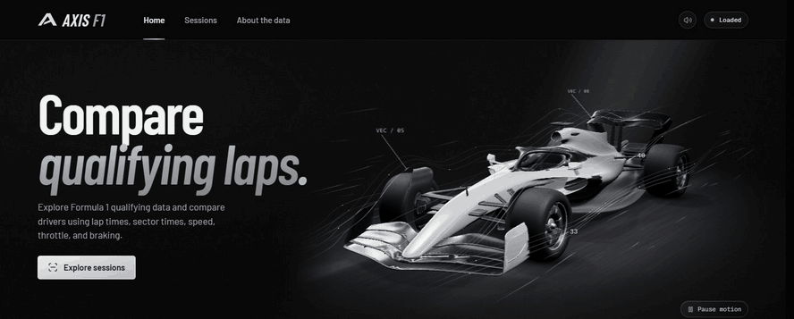
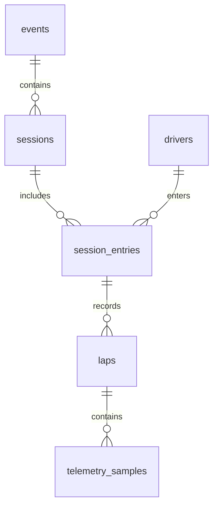
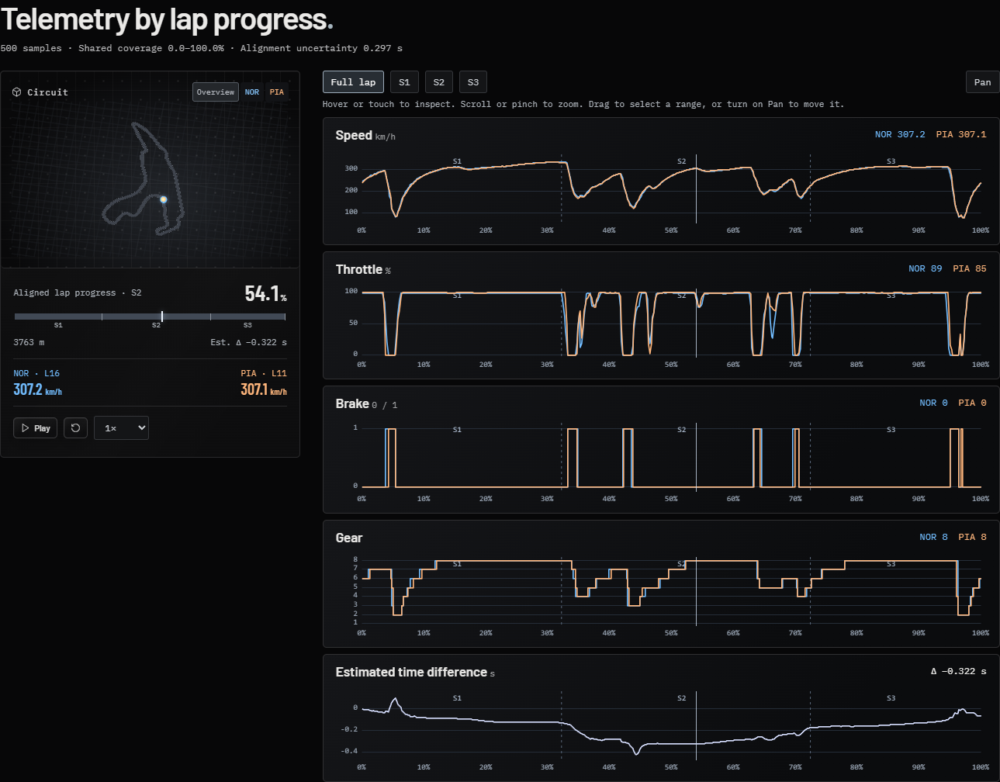
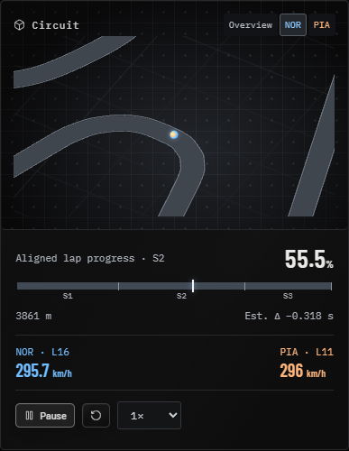

# AXIS F1

**[Explore the live website](https://axisf1.app)** ? [GitHub repository](https://github.com/gjones01/AXIS-F1) · Demonstration video coming soon <!-- Replace “Demonstration video coming soon” with [Watch the demonstration](YOUR_YOUTUBE_URL). -->

I built AXIS F1 for the graduate Databases course at New College of Florida in Fall 2026. It brings Formula 1 qualifying results and lap telemetry into one relational database. Pick an event, two drivers, and a lap for each to see where their times diverge and what each driver was doing at that point.



## Research question

Where does one driver gain or lose time relative to another on a qualifying lap, and how reliably can we locate that difference between sector timing lines? Two drivers can cover different distances through the same corner. In the Spa comparison used to study alignment, the distance channels differed by 26.4 metres over the lap. Matching the traces solely by percentage of distance travelled produced an apparent swing of about 0.4 seconds in the final chicane. [Alignment study](tests/align_traces_analysis.py) · [Method and findings](src/analysis/sector_alignment.py)

## Dataset and database design

The database covers **17 of 24 race weekends in 2025**. I limited the import to regular qualifying at selected events to stay within the PostgreSQL storage budget. This is a historical proof of concept with manually imported sessions.

| Drivers | Session entries | Lap records | Laps with telemetry | Telemetry samples | Database size |
|---:|---:|---:|---:|---:|---:|
| 21 | 339 | 5,139 | 3,245 | 2,470,950 | 403 MB |

F1DB supplies the calendar, driver identities, and qualifying entry records. OpenF1 identifies the corresponding meeting and regular qualifying session through its API. The TracingInsights archive supplies lap timing and telemetry channels. The importer reconciles the event and session across sources, then matches drivers by car number within that event and cross-checks their abbreviations. The sources can share underlying timing and telemetry records. [F1DB](https://github.com/f1db/f1db) · [OpenF1](https://openf1.org/) · [TracingInsights 2025 archive](https://github.com/TracingInsights/2025)



The first five tables use the primary keys `event_id`, `session_id`, `driver_id`, `entry_id`, and `lap_id`. Each relationship in the diagram joins a child foreign key to its parent's key. A session entry links one driver to one session. Lap numbers are unique within an entry. Telemetry samples use the composite primary key `(lap_id, sample_index)`, so a lap can have an ordered trace or a timing record alone. These keys prevent repeat imports from duplicating records. Before loading samples, the importer checks channel lengths, timestamp order, and agreement with recorded lap duration. Incomplete pit-out traces are among the laps excluded from telemetry analysis.

## Reading a comparison

Lap and sector times are **measured**. Between timing lines, the time difference is **estimated**. AXIS F1 anchors the two distance traces at the start, sector boundaries, and finish, then compares their shared coverage on a 500-point grid. A positive difference means the reference driver took longer. Speed and throttle vary continuously on the chart. Brake and gear changes appear as steps. The reported alignment uncertainty matters when interpreting small gains within a corner.



Replay follows the reference lap's recorded clock. Both markers show where the drivers were at the selected **aligned progress**. Scrubbing or selecting a sector moves the chart cursor and the circuit view together.



## Architecture and local setup

PostgreSQL runs on Supabase. A Python/FastAPI backend queries it with a server-side read-only role. Vercel serves the React/Vite frontend and routes same-origin `/api` requests to FastAPI. Three.js renders the homepage car and circuit replay.

For immediate access to the data, use the live website. Cloning the repository does not grant access to the hosted database. To run comparisons locally, supply your own populated PostgreSQL database matching the six-table schema. Set `DATABASE_URL` in the backend environment or in a local, untracked `.env` file.

Start FastAPI from the repository root in PowerShell using Python 3.12.

```powershell
py -3.12 -m venv .venv
.\.venv\Scripts\python -m pip install -r requirements.txt
.\.venv\Scripts\python -m uvicorn src.api.main:app --port 8000
```

Start Vite in a second terminal.

```powershell
cd frontend
npm ci
npm run dev
```

Open the local address printed by Vite. Its development server forwards `/api` requests to port 8000.

## Credits

[Original CGTrader model](https://www.cgtrader.com/free-3d-models/car/racing-car/f1-2022-concept-car)

Circuit outlines are adapted from Tomislav Bacinger's MIT-licensed dataset. Driver photographs have individual credits and licenses. [Circuit credits](frontend/public/licenses/circuits.txt) · [Portrait credits](frontend/public/licenses/driver-portraits.txt) · [Third-party software notices](frontend/public/licenses/third-party.txt)
